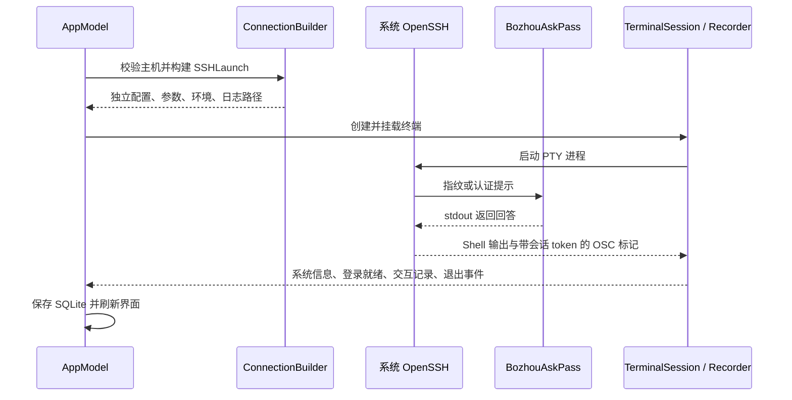

# 泊舟：AI 开发指南

本文描述当前源码与开发约定，是新会话的起点。先核对 `git status`、`VERSION` 和实际源码；不要把本地历史验收文档当作当前实现。面向用户的功能说明见 `README.md`。

## 项目基线

- 原生 macOS SSH 工作台，默认英语、可选简体中文；SwiftUI / AppKit、系统 OpenSSH、SwiftTerm、SQLite。README 默认英语，中文见 `README.zh-CN.md`。
- 开源基线 `1.0.0`，主分支 `main`，标签 `release/v1.0.0`。后续版本以 `VERSION` 为准。
- 运行目标 macOS 14+；编译需 macOS 26 SDK / Xcode 26+。源码对 macOS 26 专有工具栏 API 使用 `#available`。
- Swift Package 使用 Swift 5 语言模式，`swift-tools-version: 5.9`；不要把清单版本误认为可使用旧 SDK。
- 发布与本地验证以 Apple Silicon 为主。CI 使用 `macos-26`、Xcode 26.6、Python 3.14；本地 Python 支持 3.10+。
- 本项目使用 GPT-6-Astra 辅助开发。署名与说明不代表产品集成了在线 AI 服务。

## 开始工作

1. 只读检查分支、未提交改动、工具版本和相关源码，先保留用户已有改动。
2. 对真实服务器或用户工作空间的操作，要明确目标和授权范围。默认使用隔离测试数据。
3. 修复应覆盖问题机制，保持改动集中；完成相关测试，再更新与改动有关的文档。
4. 不将测试成功推断为全平台或远程 CI 已验证，区分本地结果与尚未执行的验证。

```sh
git status --short
cat VERSION
swift --version
xcrun --sdk macosx --show-sdk-version
python3 --version
```

若需指定 Python，设置 `BOZHOU_PYTHON` 为可执行文件路径。先运行 `bash Scripts/build.sh debug` 或 `bash Scripts/test.sh --unit`；脚本自动调用 `prepare.sh`。直接运行 Swift 命令前，在 Bash 中 `source Scripts/prepare.sh`。

## 模块与调用关系

| 文件 / 模块 | 职责与关键入口 |
| --- | --- |
| `BozhouApp.swift` | 应用、菜单、快捷键、退出确认；退出时 `closeAll()` |
| `AppModel.swift` | MainActor 状态、数据操作、连接与会话路由 |
| `HostEditor.swift`、`StableBinding.swift` | 主机编辑；可增删数组的控件绑定按 ID 查找 |
| `HostsPage.swift`、`HostListView.swift` | 文件夹与主机视图；NSTableView 即时选中及双击 |
| `HostQuickLook.swift`、`HostNameLabel.swift`、`HostDisplayName.swift` | 空格只读预览、名称与 hostname 的宽度适配展示 |
| `RootView.swift` | 单行工具栏、工作空间、标签和分屏 |
| `SessionTabs.swift`、`SearchViews.swift` | 自适应横向/竖向会话标签、页面 ⌘F、原生大文本查找高亮 |
| `IdentityTreeView.swift`、`IdentityFolders.swift` | 密钥文件夹树、目录与密钥移动事务 |
| `TerminalSession.swift` | PTY 生命周期、录制、重连；`TerminalSurface` 挂载原生终端 |
| `NativeInputTerminalView.swift` | 中文输入法组合文本，提交前不发送到远端 |
| `TerminalAppearance.swift` | 字体、色值校验及前景对比度 |
| `SFTPView.swift`、`ServerTransferView.swift` | 文件浏览和双服务器传输；异步结果用 generation 隔离 |
| `ConnectionBuilder.swift` | 参数校验、展开跳板、生成每次会话独立的 SSHLaunch |
| `SSHHostKeyFailure.swift`、`HostKeyRecoveryView.swift` | 基于本次连接的节点标识识别密钥变化、确认后定点重置信任并重连 |
| `ShellIntegration.swift`、`SystemProbe.swift`、`SystemProfile.swift` | Shell 启动 Hook、OSC 字节流解析、登录时只读系统信息采集及摘要解析 |
| `SessionDrag.swift`、`HostSearch.swift` | 原生标签拖拽/分屏提示与取消生命周期、后台主机详情搜索索引 |
| `TerminalDiagnostics.swift` | 异常退出状态、有限上下文、私有日志落盘与保留数量 |
| `SFTPClient.swift` | SFTP v3 actor；专属 DispatchQueue 执行阻塞管道 IO |
| `Store.swift`、`Models.swift` | SQLite、Codable 模型、路径与设置 |
| `HostMetadata.swift`、`PluginSettings.swift`、`BozhouExtensions/` | 通用插件注册、能力发现、启停/卸载/工作空间生命周期、元数据调度 |
| `BozhouNightHawk/`、`BuiltInPlugins.swift` | 独立 NightHawk 实现；应用唯一供应商注册入口 |
| `PluginSettingsView.swift`、`MetadataViews.swift` | 声明驱动的插件设置、元数据绑定和展示 |
| `PasswordCache.swift`、`BozhouAskPass/main.swift` | 逐主机密码复用、认证 UI 与指纹确认 |
| `WorkspaceLocation.swift` | 在线 SQLite 备份与数据目录切换 |
| `WorkspaceBackup.swift`、`WorkspaceBackupView.swift` | 版本化逻辑备份、完整性校验、新目录恢复与导入导出 |
| `AppUpdater.swift`、`ReleaseUpdate.swift`、`UpdateArchive.swift`、`BozhouUpdater` | GitHub Release 检查、流式下载、包验证与退出后替换回滚 |



## 必须保持的不变量

### 编辑和界面

- 应用文案统一使用 `BozhouCore.L10n.tr("English source key")`；英中资源位于 `Resources/Localization/`，插值用 `{0}`、`{1}`，不能翻译用户数据或协议内容。`AppSettings.language` 缺失或未知时回退英语，重启生效；AskPass 通过 `BOZHOU_LANGUAGE` 继承当前语言。页面和排序使用稳定 rawValue、独立本地化 title，业务判断不能匹配翻译后的文案。
- **不得为可删除行保留数组下标 Binding**。原 `ForEach($host.forwards)` 在移除行后被 NSTextField 延迟读取，触发数组越界；使用 `Binding.element(snapshot)`，每次按 ID 查找，删除后读快照、忽略写入。
- 跳板行的移动和删除在执行时按 ID 找当前位置，不捕获旧下标。
- 顶部保持单行平面工具栏、上下居中；避免重新引入液态玻璃背景和第二层 Header。
- 自定义主机名称与实际 hostname 均保留；hostname 同时用于展示、搜索和「登录与系统信息」。
- 名称展示优先完整 `名称(hostname)`，宽度不足使用 hostname 末六位；悬停保留完整文本。未采集时回退连接地址；历史与收藏持久化可选 hostname 快照，旧记录按 hostID 回查。
- 终端内容区头部固定为两行：名称/hostname、用户名与地址端口、文件夹路径同处第一行，连接状态独占第二行；窄分屏内截断而不新增行。
- 主机空格预览不连接、不编辑；空格/Esc 关闭，方向键同步选择，离开主机页关闭预览。启用的云元数据扩展信息位于“操作系统”之前，按完整宽度展示。
- 主机树展开状态保存在当前工作空间的 `AppSettings.expandedHostGroups`，通过 `AppModel.setHostGroupExpanded` 即时持久化，切页和重启后恢复。收起父目录保留子目录状态，搜索自动展开不改写记录；重命名/移动和删除须在文件夹事务中同步更新路径。
- 密钥使用独立 `identity_folders` 表与 `Identity.group`，展开状态为 `expandedIdentityGroups`；目录事务同步更新密钥路径与展开路径，密钥 ID 和原文件位置保持。旧密钥默认位于根目录。
- 异步密钥导入捕获开始时的 Store 实例；结果交付时核对实例身份，切换工作空间后丢弃迟到结果，普通页面切换不取消导入。
- 会话标签名称仅影响当前会话标签，不改写主机和历史名称；`tabPlacement` 按工作空间持久化。横向标签达到保留 hostname 末六位的最小宽度后滚动，不能交给原生工具栏隐藏溢出标签。竖向标签放在左侧导航下方，切换方向保持同一 PTY。
- 标签拖拽使用原生 NSDraggingSource/Destination 和当前 AppModel 作用域的私有载荷；开始拖动不得选中源标签。拖到标签前/后调整顺序，拖到另一个可见终端的四个边区显示半区动画，松开时才建立上下/左右双窗格。最多两个可见会话，其余保留；Esc、外部放下和关闭会话均清理拖拽状态。普通点击标签恢复单窗格，删除旧分屏菜单入口。
- 页面查找通过 `FindCommands` 将 ⌘F 路由到当前窗口的搜索输入框；不依赖短暂页面的 SwiftUI FocusedValue。筛选、高亮与片段提取使用 `TextSearch` 的字面量、不区分大小写及音调匹配；长文本使用原生 `NSTextView`，查找滚动不能抢走搜索框焦点。
- 搜索框内部保留草稿，停止输入 1 秒后提交；显式清空和 Esc 立即生效。焦点查找当前窗口中标识为 `page-search` 的原生输入框，避免菜单闭包引用已移除页面。历史/收藏结果按提交查询与 `libraryRevision` 后台缓存，长文本匹配支持取消；过期任务不得覆盖新结果，仅查询变化不得重建全文或重新计算文本尺寸。
- hosts/history/pins 的实际变更统一使 `libraryRevision` 失效，后台新增交互也须刷新已打开的搜索。主机底部操作只针对当前列表或网格中的可见选中主机。
- 主机搜索由 `HostSearchIndex` 在后台建立白名单字段索引，涵盖空格预览的系统摘要、备注、跳板名称和启用插件的缓存属性（隐藏字段仍可搜索）；不索引密码、环境变量和密钥。主机/元数据/插件设置变更使索引失效，仅查询变化复用索引；取消任务与 revision 校验拒绝旧结果。
- `SystemProfile` 初始化及旧数据解码均解析摘要；OS 优先 PRETTY_NAME，CPU 为 Model name 与 CPU(s) 逻辑核数，可用内存为 Linux MemAvailable 或 macOS 空闲/非活跃/预读页之和（GiB）。旧 hw.memsize 是容量，不能当作可用内存；无法解析时保持缺失，等待下次登录采集。
- 默认浅色终端背景 `#F1F2F4`，深色 `#0E141F`；不能恢复纯白底。颜色即时作用于已有终端并持久化。
- 分屏命令作用于焦点窗格；PTY 尺寸与视图同步。
- 菜单、工具栏和侧栏统一通过 `showWorkspace` 返回工作空间并清理分屏、焦点与拖动状态；没有可见主会话时 `commandSession` 必须为空。
- `TerminalSession` 持有终端和滚动历史；SwiftUI 通过 `TerminalContainerView` 挂载，不能把挂载/卸载时的零尺寸传给 SwiftTerm，否则极窄列宽重排会挤掉历史。旧容器拆卸时只移除仍属于自己的终端。
- 字体和颜色未变化时不重复设置，避免清空渲染缓存、重置终端模式和触发布局；输出尾部用有界环形缓存，按需生成快照。
- `⌘−` / `⌘=` / `⌘+` 缩放焦点终端（10–36 pt），会话内保留；显式修改设置字号重置临时缩放。快捷键不得发往远端。

### 连接和异步生命周期

- 插件默认关闭。`BozhouExtensions` 仅依赖 Core；`BozhouNightHawk` 依赖通用插件接口，应用仅在 `BuiltInPlugins.swift` 注册供应商。新增插件开发入口见 `PLUGIN_DEVELOPMENT.md`。核心和通用 UI 不导入供应商模块，不匹配供应商 ID。
- `BozhouPlugin` 声明描述、设置和类型化能力；`PluginRegistry` 提供注册、启用、禁用、注销、工作空间停止和退出清理。停用时先使 `PluginContext.isActive` 失效并取消其任务，再调用清理钩子。异步能力交付结果前须校验 context；核心的元数据调度还校验任务 token、provider ID 和 subjectKey。配置变化重建激活上下文，仅字段布局变化不重启查询。注销保留持久化配置，重新注册可复用。
- `HostMetadataProvider` 是可选能力。只向它传递 `MetadataSubject` 的主机名称、hostname、地址和绑定条件，不传密码、Shell 环境或密钥。没有元数据能力的插件可独立启停；新增终端或 AI 能力必须显式定义受限接口和消费端，不能绕过接口获取 AppModel/Store。
- NightHawk 使用现有本地 CLI/SSO，显式传 `--env`、`--output json`，不安装、登录或修改 CLI 全局配置。自动候选 `iv-* → i-*` 必须核对该 ECS 的网卡地址、`device_id` 及实例绑定账号；网卡可合法属于其他账号，其关联资源须按网卡记录中的账号分别核对。无可靠 ID 的私网 IP 不自动关联，用户可明确绑定 ID/region/account/env。
- 查询先取 schema，再使用其 list URL；不硬编码后台接口。动态展开 detail 和全部 ECS list 列，字段标识使用属性路径，数组行号和资源 ID 不作为显示规则键；标签按 tag key 区分，资源来源不得混淆。关联展开仅限 ECS 直接网卡的 ENI/VPC/subnet/EIP，不递归扫描 VPC 主机。
- 元数据队列串行、主机去重、缓存 15 分钟；实际 CLI 请求间隔至少 1.2 秒，429 统一暂停 60 秒并对该次请求重试一次，等待可取消。CLI 单次超时 20 秒、输出 8 MiB，单主机最多 96 次请求且请求启动窗口 180 秒，直接关联资源最多 16 个，每列表最多 10 页/500 行。展示值合计约 1 MiB、每属性 16 KiB/最多 4000 属性；截断或部分失败必须可见。禁用、删除和切换工作空间取消任务，token 校验拒绝迟到结果。
- `Store.saveMetadata` 在事务中核对当前 `MetadataSubject.key`，仅更新 metadataSnapshots；编辑器通过 `saveHostPreservingObservations` 保留后台采集。`AppSettings.plugins` 保存插件配置和默认字段规则，沿用 `metadataExtensions` JSON 键，兼容读取旧 executable/environments。供应商默认值由插件提供。Host 的 `metadataLayouts` 可覆盖；旧数据缺失扩展字段时使用空字典。

- `TerminalSession.start()` 必须拒绝已关闭或已结束的会话，防止视图排队的迟到启动创建后台进程。
- 每次 SSH 重连重新构建配置和 PTY；旧进程回调用 `source === terminal` 等条件排除。不得重放用户命令。
- 重连等待依次为 5、10、30、60、120 秒，用尽后由用户手动发起。Shell 外层临时启动脚本在退出时发送带会话 token 的完成标记，区分 `exit 255` 与传输失败。只有状态 0 自动关闭标签；非零或未知状态先完成交互记录并保存上下文，保留窗格。Shell 非零退出不触发传输重试。
- PTY 退出通知必须晚于 EOF 和已排队输出交付；后台子进程持有 slave 时最多等 2 秒，然后取消读取并交付尾部。SwiftTerm 改动只写入 `Patches/`。
- SFTP 取消关闭传输；连接、目录、进度和错误回调均要验证 generation，不能让旧任务覆盖新任务状态。
- SFTPTransport 的启动与取消通过锁协调；管道 IO 不进入主线程，帧大小、超时、取消与 SIGPIPE 保护不可删除。
- 服务器间传输使用有界内存、目标临时文件及最终 rename；失败尽力清理并告知残留路径，不覆盖已有文件。

### SSH 和凭据

- 使用系统 `/usr/bin/ssh` 和独立 `-F` 配置，不依赖用户 `~/.ssh/config`。指纹库独立，首次需确认、变化时拒绝。
- 经跳板或网络代理的每一级 SSH 使用稳定 `HostKeyAlias`：按完整路径前缀的地址、端口及代理类型生成版本化 SHA-256 标识。SSH/SFTP、重连、改名和凭据修改共用同一路径的指纹；不同路径的同地址互不冲突。直连沿用地址/端口记录；旧版路由指纹需重新确认，不能自动继承无路径信息的旧记录或清空指纹库。
- 主机重装后的密钥变化仍须拦截。`SSHLaunch.hostKeyEndpoints` 保存本次实际目标与跳板的信任标识；仅登录就绪前将 PTY 子 SSH 输出和外层日志合并识别 `host_key_changed`，不能把远端命令输出当成信任变更。SSH/SFTP/双服务器界面可在用户核对指纹后删除该节点的旧记录，支持 OpenSSH 哈希和逗号列表，保留其他节点、路径及 CA/撤销记录；核对期间指纹库变化须拒绝过期重置。重连仍需 OpenSSH 首次指纹确认，不自动接受替换密钥。
- 跳板每级保留自己的主机 ID、认证、用户名和端口；嵌套 ProxyCommand 的路径需同时正确处理 Shell 引用和 OpenSSH `%` 展开。
- 密码按当前产品行为明文存于数据库；不得输出到工具日志、进程参数、环境变量或提交。私钥仅保存路径，口令和验证码不持久化。
- AskPass 使用 `Store.savePassword` 仅更新凭据字段，不能回写旧 Host 快照覆盖其他字段。
- 本地转发绑定 `127.0.0.1`，端口冲突使连接失败；SFTP 连接不启动转发。
- 不改写用户或服务器持久化 Shell 配置；不自动安装插件或远端 Agent。
- Zsh 使用原生 `preexec_functions` / `precmd_functions`，不得复制或替换用户 `precmd`；Hook 选项用 `emulate -L zsh` 隔离，内部变量使用 `__bz_` 前缀。临时启动文件由启动脚本兜底清理。用户主动覆盖 Bash `PROMPT_COMMAND` 或清空 Hook 数组允许记录降级，不拦截配置操作。

## 数据与兼容性

- 默认根目录 `~/Library/Application Support/Bozhou/`。`BOZHOU_DATA_DIR` 优先级最高，其次 UserDefaults 的 `workspacePath`，最后默认目录。
- 数据库 `bozhou.sqlite` 使用 WAL。表：`hosts`、`folders`、`identities`、`identity_folders`、`snippets`、`history`、`pins`、`settings`；记录以 JSON payload 保存。`identity_folders` 为兼容性新增表，旧 schema-2 客户端可打开并保留该表。
- 数据库 schema 当前 `user_version=2`，独立于应用版本。**应用回到 1.0.0 不代表将数据库 schema 降为 1**。
- Codable 新字段提供兼容默认值；旧主机、设置、系统信息和日志仍需可读，不能仅为“删除旧逻辑”去掉迁移支持。
- 文件夹操作使用事务。Pin 依命令+输出去重，独立于历史裁剪；单条输出最多 256 KiB、会话侧栏最多 100 条。
- 数据目录迁移使用 SQLite backup API，包含已提交 WAL；目标需为空、互不包含，先校验复制结果再切换指针，保留原目录。
- `.bozhoubackup` 使用版本化二进制 plist 信封与 SHA-256 完整性校验，包含所有已知记录表、设置、指纹和日志，不包含外部私钥或临时会话。导入只解码类型化记录，不能执行外部数据库。备份上限 512 MiB，文件 0600；恢复到新目录、验证后切换启动指针并保留旧目录。工作空间由 `BOZHOU_DATA_DIR` 固定时不得切换。
- `Scripts/migrate_workspace.py` 仅用于旧开发工作空间 `.runtime/app` 到默认目录的安装兼容，不覆盖已有数据。
- 会话目录可清理，SSH 原始日志单独保留；应用结构化日志有轮转。
- 异常上下文独立于历史开关保存在工作空间 `logs/*.terminal-context.json`，仅当前用户读写（0600），最多 20 份。只保留终端尾部 64 KiB、SSH 尾部 16 KiB、本次连接最近 5 条交互（每条命令 4 KiB / 输出 8 KiB）；替换当前主机保存密码，不采集环境、SSH 配置或按键。关闭会话不能删除报告；未知敏感业务输出需由用户在分享前检查。

## 构建与依赖

- `Vendor/SwiftTerm` 和 `Vendor/bash-preexec` 是固定提交的 Git 子模块，版本见 `THIRD_PARTY_NOTICES.md`。
- `prepare.sh` 复制并补丁 SwiftTerm 到 `.runtime/SwiftTerm`；根 Package 仅编译其库源码，避免拉入演示依赖。
- 原生应用测试通过 `native_test_support.sh` 读取 SwiftPM 的当前 Objects.LinkFileList；不使用依赖目录的 `*.o` 通配符，避免链接源码移动后的残留对象文件，新插件模块自动纳入测试链接。
- Bash 资源由子模块复制到 `Sources/BozhouCore/Resources/`。生成副本不入 Git、不手改；更新依赖应改 gitlink 与 `Patches/`。
- `build.sh` 打包 Bozhou、BozhouAskPass、BozhouUpdater 三个可执行文件与资源包。已生成图标在 `Resources/`；需要改图标时手动运行 `generate_icon.swift` 与 `iconutil`，构建不重复改图标。
- 预览可设置 `BOZHOU_APP_OUTPUT` 为新的绝对 `.app` 路径，`build.sh`、`package_app.py` 和 `verify_package.py` 共用该输出位置；默认仍为 `dist/泊舟.app`。`BOZHOU_PREVIEW_BUILD` 写入关于页面的本地预览标记。
- `VERSION` 是发布版本源，`package_app.py` 写入 Info.plist，关于页面读取 Bundle 版本；裸可执行文件显示“开发构建”。
- 资源使用明确白名单，`verify_package.py` 验证；禁止将 `Docs/`、真实工作空间或调试材料整目录复制入包。
- `Scripts/install.sh` 使用与构建一致的 `BOZHOU_APP_OUTPUT` 作为来源，默认安装到系统级 `/Applications/泊舟.app`；仅在调用方显式传入目录时使用其他安装位置。
- 当前 ad-hoc 签名，无 Developer ID 或公证。更新源固定为 `sancppp/Bozhou` 的 GitHub Release；启动仅检查，下载及安装须用户主动触发。只接受较新的稳定三段版本及匹配的 arm64 ZIP/SHA256SUMS，验证下载上限、SHA-256、ZIP 双重路径、链接、展开大小、bundle ID、版本和代码签名；Mach-O 架构校验不依赖 Xcode。
- 更新 helper 与本地化资源先复制到安装目录旁的私有暂存目录，等待原进程退出后替换并启动；超时不能替换。旧 app 保留，替换或启动命令失败时回滚，不接触工作空间。安装目录无写权限应报错，不自动提权。`BozhouApp` 单独触发启动检查，测试创建 `AppModel` 不能访问 GitHub。

## 验证选择

| 变更范围 | 命令 |
| --- | --- |
| 核心逻辑、数据、解析、Shell | `bash Scripts/test.sh --unit` |
| Shell 真实 PTY、嵌套 Shell、Vim、粘贴、尺寸压力 | `bash Scripts/test.sh --shell-stability` |
| SSH、认证、多跳、SFTP、转发 | `bash Scripts/test.sh` |
| 编辑绑定、终端切换/滚动历史/关闭释放、取消回调 | `bash Scripts/test_regressions.sh` |
| 元数据扩展设置、编辑合并、缓存及双语布局 | `bash Scripts/test_metadata.sh` |
| 原生终端输入 | `bash Scripts/test_native.sh` |
| 主机键鼠交互 | `bash Scripts/test_hosts.sh` |
| 多会话、分屏、尺寸、颜色 | `bash Scripts/test_hosts.sh --layout` |
| 真实 Window 工具栏 | `bash Scripts/test_titlebar.sh` |
| 安装迁移 / 打包 | Python 执行 `Scripts/test_install.py` / `Scripts/verify_package.py` |
| 更新 helper 退出等待、替换与启动 | 打包后 Python 执行 `Scripts/test_update_helper.py`，仅操作临时签名 fixture |

公开更新检查可显式运行 `.build/debug/BozhouCoreTests --verify-update-feed <新建临时目录>`；原生启动/手动更新界面用 `BOZHOU_VERIFY_UPDATE_UI=1 bash Scripts/test_titlebar.sh`。这两项会访问公开 GitHub，默认回归不联网。

显式授权后的云元数据只读验证：`.build/debug/BozhouCoreTests --verify-metadata <选择器JSON> <新建输出目录>`。JSON 为最多 10 项数组，仅含 `name`、`hostname`、`address`，可选 `resourceID`、`region`、`accountID`、`environment`；不读取或修改真实工作空间，结果仅写指定私有目录，真实数据不得提交。默认单测使用匿名内存 fixture。

集成 fixture 仅在 `127.0.0.1` 创建随机端口，不连接真实服务器。不要并发运行同一工作区的构建或 fixture。原生回归脚本自动创建临时 `BOZHOU_DATA_DIR`；布局测试会启动本地 Zsh，可能读取当前用户配置，需要时使用隔离 HOME/ZDOTDIR。

Shell 稳定性测试使用临时 HOME；可通过 `BOZHOU_TEST_BASH` 增加另一版本 Bash，`BOZHOU_TEST_OMZ` 指向已有 Oh My Zsh，不安装或更新插件。测试明细在 `.runtime/shell-stability/`，远端复用脚本须先获得真实主机授权。

真实主机探测入口 `--probe-host`、`--live-terminal` 仅限用户明确授权的工作空间和主机；不是默认测试。不要用带完整参数的进程列表检查未知进程，避免暴露认证信息。

## Git 与交付

- `main` 保持可构建；常规修改使用短分支和 PR。不要在后续任务中再次重建历史。
- 提交使用 Conventional Commits；Git author/committer 为 `Zhenxiong Tian <sancpp@qq.com>`，不要在 message 中重复 `Author:`。GPT-6-Astra 实质参与的提交添加 `Co-authored-by: GPT-6-Astra <noreply@openai.com>` 和 `Signed-off-by: Zhenxiong Tian <sancpp@qq.com>` trailers，并使用维护者密钥做加密签名。AI 邮箱仅为协作审计标识，不表示 GitHub 账号或责任主体。
- `release/vX.Y.Z` 使用 signed annotated tag，必须匹配 `VERSION`，指向最终通过测试的提交。
- `CHANGELOG.md` 最新章节对应当前发布版本；Release 工作流将该章节作为发布说明。
- `.github/workflows/ci.yml` 仅验证 PR / main；`.github/workflows/release.yml` 仅由 `release/v*` tag push 触发，测试通过后以 `contents: write` 创建公开 Release，并附带 Apple Silicon ZIP、SHA-256 与 MD5 校验文件。同版本重新发布时更新说明并替换这三个附件；移动已发布 tag 须有用户明确授权。
- Actions 使用各官方 README 推荐的稳定大版本标签，Dependabot 更新 Actions 和子模块。更新 runner/Xcode 时核实实际可用版本。
- 远端分支保护、必需检查与私密漏洞报告开关属于 GitHub 仓库设置，不能声称 YAML 已替代这些配置。
- `Docs/`、`.dbg/`、`panic.log`、历史目标文档、本地数据库、`.runtime/`、`.build/`、`dist/` 均不提交。`Docs/` 可保存本地验收报告，但新会话与构建不能依赖它。
- 交付说明包括改动、实际测试结果与尚未验证的部分；不要提交或分享凭据、私钥、内部主机地址和用户业务输出。
